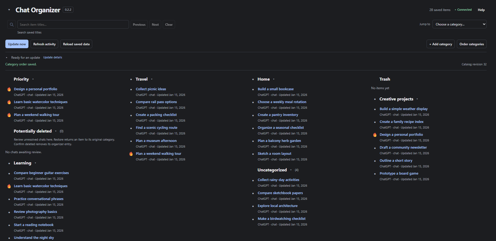

# Chat Organizer

Find and organize **unarchived ChatGPT and Codex conversations** in a searchable, categorized view inside the desktop app.

**Archived chats are excluded from this view.** If a chat still appears after you archive it, use **Update now**. The organizer hides it once its archived status is confirmed. This version has no option to show archived chats.

Chat Organizer saves a local catalog of chat and project titles, links, categories, activity dates, and focus marks. It provides a wide-screen board, nested categories, and a compact header with search and navigation controls.



The preview uses fictional example data. This public package is version **0.2.2**.

**Experimental Windows desktop integration.** The organizer requires a compatible Codex desktop host with local plugins, MCP Apps, and native chat/project tools. Automatic discovery depends on host capabilities and local metadata schemas. Fresh-account access and other operating systems require additional integration testing.

**Desktop app required. This package does not run in ChatGPT on the web or on mobile.** It launches a local service and uses metadata on the computer. A future web edition would need a shared service and changes to source access and chat opening; see [Web support](docs/data-and-compatibility.md#web-support-and-a-shared-catalog).

Read the [illustrated screen guide](docs/user-guide.md) for the numbered controls, menus, and everyday use. A [single-file HTML copy](docs/user-guide.html) can be downloaded and opened locally. The guide uses screenshots supplied by the organizer's author.

## Features

- Categories and two levels of subcategories, with a customizable top-level order.
- A permanent Trash category with a fixed name and adjustable position, for collecting items to archive separately.
- Flame marks for important chats and a Priority view that collects them.
- Search across saved titles, amber highlighting, automatic expansion of hidden matches, and Previous/Next controls that stay visible while scrolling.
- Jump to category, return to top, and a collapsible header.
- A responsive board with up to four columns.
- Project membership, linked chat identities, and user category assignments stored separately.
- Explicit update status with named exceptions and a review area for repeatedly unresolved chats.
- Local SQLite storage, optimistic revision checks, and maintenance leases for overlapping update requests.

The package includes source, tests, an icon, and a build that produces a local plugin marketplace.

## Requirements

| Component | Requirement |
| --- | --- |
| Desktop host | Windows Codex desktop with local plugin and MCP Apps support |
| Node.js | Version 24 or newer, available as `node` to the desktop app |
| Source build | pnpm 11.25.0 |
| Plugin installation | A Codex CLI exposing `codex plugin marketplace add` and `codex plugin add` |
| Metadata updates | Native `list_projects`, `list_threads`, and `list_archived_threads` tools |
| Chat verification | Native `read_thread` tool |
| Opening chats | The host's supported link or conversation navigation route |

The local server supplies the organizer interface and saved catalog. The assistant in the hosting conversation runs metadata updates using tools supplied by the desktop app. A generic MCP client can use the catalog tools, but the complete interactive workflow requires the host capabilities above.

## Getting started

Use a ChatGPT data export to establish the historical catalog, then use Update now for current app metadata.

1. Request a ChatGPT data export from **Settings → Data controls → Export data**. Wait for the download and extract the ZIP locally. See the [official export instructions](https://help.openai.com/en/articles/7260999-exporting-your-chatgpt-history-and-data).
2. Install Chat Organizer using one of the methods below.
3. Import the extracted conversation metadata into a fresh organizer catalog, following [First import](docs/first-import.md). Complete this before pressing Update now.
4. Open the organizer. Every imported chat begins in **Uncategorized**, with no flame mark. The importer skips records explicitly marked archived and reports their count.
5. Press **Update now** to add available local Codex chats and reconcile current source metadata.
6. Create your own categories and move items from Uncategorized. Add flames for the chats you want collected under Priority.

The export supplies the ChatGPT history included in that export. Codex desktop discovery supplies available local Codex records separately. Export availability and completeness depend on the source account and workspace.

## Install from source

Download or clone this repository and open PowerShell in its root directory. Install the requirements first, then run:

```powershell
pnpm install --frozen-lockfile
pnpm test
pnpm build
codex plugin marketplace add "./dist/marketplace"
codex plugin add chat-organizer@chat-organizer-community
```

The build creates `dist/marketplace`, containing the bundled plugin and its marketplace catalog. Keep this directory available as the configured marketplace source for future updates.

After completing the initial export import, fully quit and reopen the desktop app. Select the installed **Chat Organizer** plugin in a chat and ask it to open Chat Organizer. The plugin ID is `chat-organizer`; its MCP server namespace is `chat_organizer`.

Codex supports local marketplace directories and the `plugin@marketplace` installation form. See the [official plugin packaging guide](https://developers.openai.com/plugins/build/plugins) and [developer command reference](https://learn.chatgpt.com/docs/developer-commands).

### Install a built marketplace archive

If you received `chat-organizer-0.2.2-plugin.zip`, extract it and open PowerShell in the directory that contains its `.agents` and `plugins` folders. Install from that directory:

```powershell
codex plugin marketplace add "."
codex plugin add chat-organizer@chat-organizer-community
```

Node.js and the compatible desktop host are still required. The built plugin includes its JavaScript dependencies.

## Initial import and ongoing use

From the source repository, import an extracted export directory or its conversation JSON file:

```powershell
pnpm import:export -- "C:\ChatGPT export"
```

Replace the example path with your extracted export directory. The importer stores titles, stable identifiers, links, and dates. It reports the imported count, archived records skipped, and metadata warnings. Every imported chat starts in Uncategorized. Its fresh-catalog requirement protects existing organization. Update now subsequently establishes current source project membership. See [First import](docs/first-import.md) for the complete sequence and supported input formats.

After this initial population, **Update now** asks the hosting assistant to discover currently available chats and projects. The assistant retrieves the bundled workflow with `get_maintenance_workflow`, then runs it through the organizer service and native app tools. The update may take a few minutes and produces a coverage report.

Update now combines the recent sidebar, current local interactive chats, and recent cached ChatGPT metadata. The sidebar request is bounded to 50 entries and the cache window is 30 days. Historical ChatGPT coverage comes from the initial export. The update report identifies unavailable sources and incomplete verification.

The metadata workflow treats source titles and returned chat content as data. It uses explicit archive or missing-item evidence and retains saved entries when a partial listing cannot establish their status.

Once items appear, use an item's bullet to choose a category or add a flame. Category moves update organizer labels. Source project membership remains a separate field used to group chats inside their projects. **Trash** is a permanent category: its name and existence are protected, and its position can be changed with Order categories. Moving an item there does not archive it. Archiving source conversations requires a separate explicit request or action in the host app.

### The three update buttons

| Button | Use it to |
| --- | --- |
| **Update now** | Discover recent items, refresh source metadata, and perform up to eight eligible saved-chat verification checks through the assistant |
| **Refresh activity** | Refresh titles and activity dates of existing local Codex chats |
| **Reload saved data** | Display the latest organizer data already saved by another panel or operation |

Updates start when requested. This package creates no recurring schedule. The stored catalog revision increases when saved items or their organization change. The software version identifies the installed release.

## Data and privacy

On Windows, the default catalog is `%LOCALAPPDATA%\ChatOrganizer\catalog\catalog.sqlite`. Set `CHAT_ORGANIZER_DATA_DIR` to an absolute directory in the plugin process environment to choose another location. Configure that value before the first run if you want the catalog elsewhere. Moving an existing catalog needs a deliberate copy after the organizer is closed.

The catalog contains titles, identifiers, links, organization choices, and update status. Maintenance reads app metadata and may ask the host to read a chat for verification or a usable title. Those requests and reports pass through the hosting assistant. The organizer has no separate telemetry collector or external storage service.

Keep catalogs, backups, and diagnostic screenshots private when opening issues or publishing a fork. Detailed storage, source access, and uncertainty behavior are described in [Data and compatibility](docs/data-and-compatibility.md).

## Troubleshooting

| Symptom | Action |
| --- | --- |
| `node` cannot be started | Install Node.js 24 or newer and make it available to the desktop app, then restart the app |
| Organizer tools or panel are unavailable | Confirm the plugin is installed and enabled in a host with MCP Apps support |
| Update now is unavailable | Open the organizer in an assistant conversation whose host can accept the update request |
| Missing native chat tools | Use a compatible desktop installation and report which required capability is unavailable |
| An item has an unavailable host or failed verification | Review the named exception. An access failure alone does not establish deletion |
| Saved data changed / stale revision | Press **Reload saved data**, then retry the category edit |
| An update is already active | Allow that run to finish, then reload its saved result |
| The version badge shows an older release | Fully quit and reopen the desktop app after reinstalling the updated plugin |

After three qualifying unresolved verification attempts, spaced at least six hours apart, a chat may appear under **Potentially deleted** for review. Restore returns it to its original category. Confirm deleted records your decision to hide its organizer entry. Rate limits and access-denied errors are handled separately from these unresolved checks.

## Development

The UI is plain HTML, CSS, and JavaScript. A Node.js MCP server validates requests and maintains the SQLite catalog. The build bundles server dependencies with esbuild and copies the UI, icon, workflow, and manifests into a local marketplace.

```powershell
pnpm test
pnpm build
```

Tests use temporary catalogs and synthetic metadata. Desktop integration tests require a compatible host, while source unit and protocol tests run locally. See [Validation](docs/validation.md) for this package's tested scope and remaining verification.

## License

MIT, copyright 2026 Chat Organizer contributors. See [LICENSE](LICENSE). The license text follows the [Open Source Initiative's MIT license](https://opensource.org/license/mit). Dependency license notices are included with the built package.
