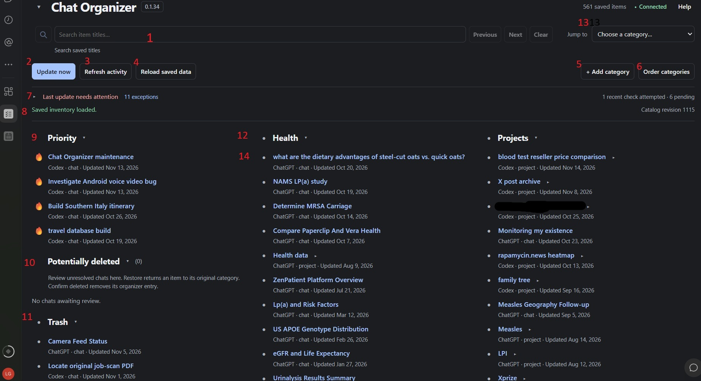
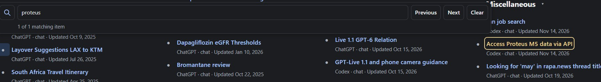
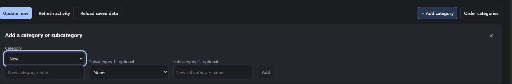
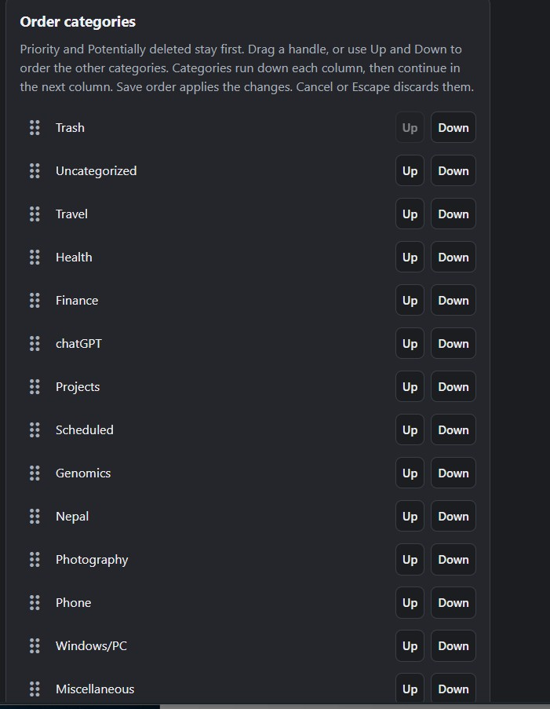
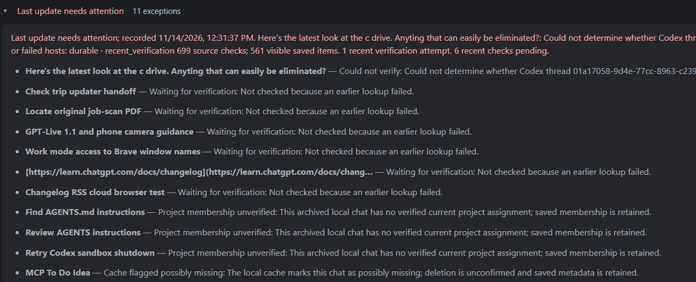
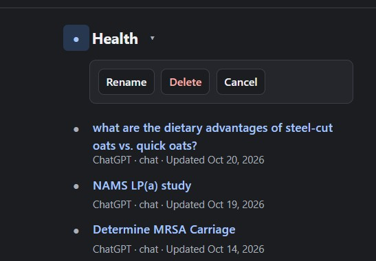
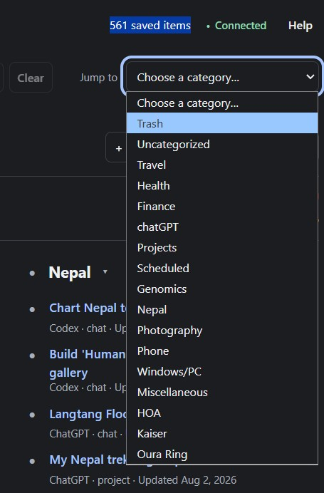
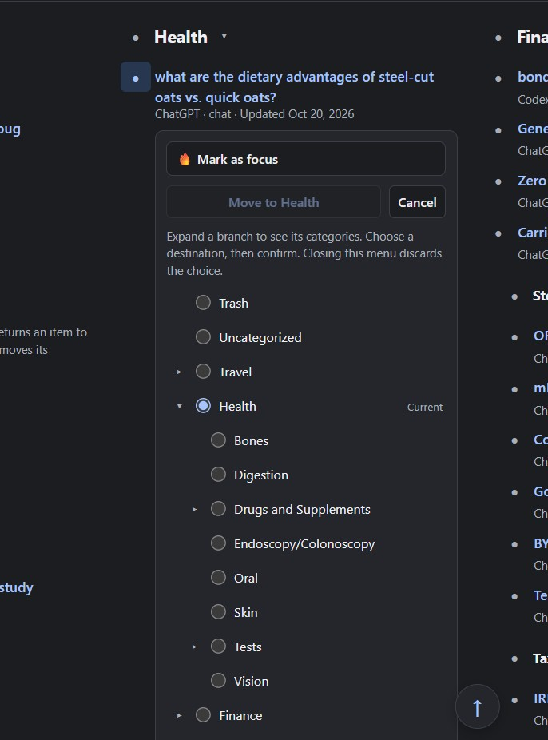

# Chat Organizer user guide

Find an **unarchived chat** by its title, group it in a category, and open it from one place. This guide follows the red numbers in the overview screenshot and explains the menus shown in the accompanying images.

**Archived chats are excluded from this view.** If a chat still appears after you archive it, use **Update now**. The organizer hides it once its archived status is confirmed. This version has no option to show archived chats.

**Desktop app required.** This package runs in a compatible Windows Codex desktop installation. It currently cannot run as a plugin in ChatGPT on the web. See the [installation instructions](../README.md) and [first import guide](first-import.md) before using it for the first time.

The screenshots were supplied by the organizer's original user and show version 0.1.34. This guide describes public version 0.2.2. The personal categories, chat titles, dates, counts, and status messages in the screenshots are examples from that installation. The current search controls are narrower, and Trash now has a protected name and cannot be deleted. The existing blacked-out title is preserved.

## Screen overview

Use the numbers to find a control below. The numbering also matches the close-up screenshots. The arrow before **Chat Organizer** collapses the header controls. An active search remains available. **Help** displays a short reminder of the main controls.

| Number | Item | Number | Item |
| --- | --- | --- | --- |
| [1](#1-title-search) | Title search | [8](#8-operation-messages) | Operation messages |
| [2](#2-update-now) | Update now | [9](#9-priority) | Priority |
| [3](#3-refresh-activity) | Refresh activity | [10](#10-potentially-deleted) | Potentially deleted |
| [4](#4-reload-saved-data) | Reload saved data | [11](#11-trash) | Trash |
| [5](#5-add-category) | Add category | [12](#12-your-categories) | Your categories |
| [6](#6-order-categories) | Order categories | [13](#13-jump-to-a-category) | Jump to a category |
| [7](#7-update-exceptions) | Update exceptions | [14](#14-chat-actions) | Chat actions |

## 1 Title search

Type a word or part of a title, then click the **magnifying glass** or press **Enter**. Search looks for that text anywhere in saved item titles and ignores capitalization. It does not search the contents of a chat.

The first search exposes all matching titles, including matches inside collapsed categories and projects. Matches turn amber, and the page moves to the first match. **Previous** and **Next** move between matches and wrap around at either end. The search controls stay at the top while you scroll. Their total width is capped at 640 pixels, with a smaller width on narrow screens, so they cover less of the item area.

**Clear**, or **Escape** in the search box, removes the highlighting and restores branches that search opened. After a search, **Enter** moves to the next match and **Shift+Enter** moves to the previous one.

## 2 Update now

Use **Update now** to discover recent chats and refresh source metadata, including titles, project membership, and known archive status. It asks the assistant in the hosting conversation to run the update; allow it time to finish.

Each run also attempts **up to eight eligible saved-chat verification checks**. These usually concern chats updated within the last 30 days, plus older chats with an unresolved failed-check history. An item must wait at least six hours between verification attempts. Eligibility and source availability affect the actual number checked. An earlier failed lookup can leave later checks pending. Repeated clicks do not guarantee that a particular item will be checked immediately.

The update preserves your categories, category order, and flame marks. Confirmed archived chats disappear from the organizer's display; saved metadata can remain in its database. Updates run when requested. No recurring schedule is created by this package.

For your initial history, start with a data export and the [first import process](first-import.md). Recent discovery does not establish complete historical coverage.

## 3 Refresh activity

**Refresh activity** rereads the titles and last-activity dates of **local Codex chats already saved in the organizer**. Use it after working in or renaming one of those chats when its displayed title or date looks stale. Your categories and flame marks are preserved.

It does not discover new chats or refresh regular ChatGPT or web Work activity. Use **Update now** for broader synchronization.

## 4 Reload saved data

**Reload saved data** rereads the organizer's own saved catalog and redraws the page. Use it after another organizer window or the assistant has changed that catalog, for example after an archive operation whose results were already saved.

It clears old chat-opening error messages and discards an unsaved category-order draft. It does not check chat sources or run a synchronization.

| If you want to… | Use |
| --- | --- |
| Find newly created chats or update source status | **Update now** |
| Refresh an existing local Codex chat's title or activity date | **Refresh activity** |
| See changes already saved to the organizer | **Reload saved data** |

## 5 Add category

Click **Add category** to expand the editor. You can use three levels: a category, a subcategory, and a subcategory within that subcategory.

Choose **New…** and enter a name for a new top-level category. To add a lower level, select its existing parent and supply the new name at the appropriate level. Click **Add** to save it.

These are your organizer labels. Moving a chat between them does not move the source chat between ChatGPT or Codex projects.

## 6 Order categories

Click **Order categories** to arrange the top-level categories. Drag a handle, or use **Up** and **Down**, then click **Save order**. **Cancel** or **Escape** discards an unsaved order.

**Priority** and **Potentially deleted** stay first. The remaining categories, including **Uncategorized** and **Trash**, can be reordered. Categories run down one column, then continue in the next. The number of columns adjusts to the available width.

## 7 Update exceptions

Expand the update-status line to see the full report and named exceptions. These explain what the update could not establish.

- **Could not verify:** a particular lookup failed. An unavailable or failed “durable” host does not prove that the chat was deleted.
- **Waiting for verification:** the chat was not checked during that run, sometimes because an earlier lookup failed.
- **Project membership unverified:** the source did not establish current membership, so the saved assignment was retained.
- **Cache flagged possibly missing:** cached metadata raised a question, but deletion remains unconfirmed.

The screenshot shows one installation's report. Some exceptions can persist even while new chats are being discovered successfully. Review the names and reasons rather than assuming every warning means a deleted chat.

## 8 Operation messages

The message area reports results such as **Saved inventory loaded**, a successful category move, or an error. The update-status line above it summarizes the last update; expand it for details.

**Saved items** counts the visible entries after filtering and linked-identity handling. **Source checks** in an update report can count multiple observations of the same item and can include archived or hidden records. Those two counts do not need to match.

The number beside the title is the **software version**. **Catalog revision** is a separate counter that advances when saved items or their organization change.

## 9 Priority

**Priority** is a permanent view at the beginning of the organizer. It collects chats you have marked with a flame.

The chat also remains in its normal category or project. Both appearances refer to the same saved item. Remove the flame and its Priority appearance disappears; its normal location is retained. Chats awaiting review under Potentially deleted are kept out of Priority until resolved.

## 10 Potentially deleted

**Potentially deleted** is a permanent review area after Priority. A chat can enter it after **three qualifying failed individual checks, each at least six hours apart**. The earliest possible first-to-third interval is twelve hours, and it can take longer because checks happen during requested updates. Three clicks on Update now are not three qualifying failures.

Rate limits, sign-in or permission failures, network errors, and timeouts do not count toward this threshold. A successful individual check resets the failed-check history. An item can also be added for review at your explicit request.

The original category and flame are retained while the chat is shown here. Automatic checks pause for that item until you review it.

- **Restore** returns it to its original category and resets the failure history.
- **Confirm deleted** records your decision and hides its organizer entry. It does not delete the source conversation.

Review status means the organizer could not settle the question. It is not proof of deletion.

## 11 Trash

**Trash** is a permanent category provided by the organizer. Its name is fixed, and it cannot be deleted. You can change its position using **Order categories**. Use it to collect chats you intend to archive.

When updating an existing catalog, the organizer reuses its top-level Trash category, including the items already assigned to it. If there is no top-level Trash category, it adds an empty one.

**Moving a chat to Trash does not archive it, and Update now does not automatically empty Trash.** Ask the assistant separately to archive the chats currently in Trash, or archive them yourself in the source app. The assistant's ability to do that depends on its available tools and access.

After archiving, use **Update now** to discover the archive state, or **Reload saved data** if the assistant has already updated the organizer. Confirmed archived entries disappear from view while their saved metadata can remain. An item that cannot be archived should stay available for your review.

## 12 Your categories

**Health** is an example of a user category in the screenshots. Click the dot beside a category or subcategory to **Rename** or **Delete** it. Use the arrow beside its name to collapse or expand it.

Deleting a category also removes its subcategory branch and moves the assigned items to **Uncategorized**. The source chats are preserved. The interface offers **Undo** for the latest category deletion until a later conflicting change makes that undo unavailable.

## 13 Jump to a category

Use **Choose a category…** beside **Jump to** to position a top-level category near the top of the visible item area, whichever column contains it. This changes your scroll position, not any item's category.

The list includes normal top-level categories, including Uncategorized and Trash. Priority and Potentially deleted are omitted.

## 14 Chat actions

Click the dot, or existing flame, beside a chat to open its action menu.

- **Mark as focus** adds the flame and makes the chat appear in Priority. Use the same control to remove the mark later. Flame-marked chats also remain visible inside collapsed projects.
- To move the item, expand the destination branch if needed, select a category, and click **Move to…**. Closing the menu without confirming discards the selection.
- Clicking the **title** opens the original conversation using the route described under Random notes below.

Moving a chat to a category, including Trash, changes its organizer assignment. Archiving is a separate action.

## Uncategorized and return to top

**Uncategorized** is protected from removal, but its position can be changed with Order categories. Every active chat imported from the initial export begins here. Newly discovered, otherwise unassigned items also begin here; current project membership can group chats under their projects.

The count beside Uncategorized is the number of entries listed directly in that category. It does not count every chat nested inside a project displayed there.

The floating **up arrow** near the bottom center of the item area returns to the top of the organizer.

## Random notes

### Where a chat opens

| Chat type | Opening route in this package |
| --- | --- |
| Regular ChatGPT conversation, including one originally started on the web | Desktop app, through a request to the hosting assistant |
| Local Codex Work chat | Desktop app, through its native chat link |
| Web Work chat positively linked to its web conversation | Browser, at its verified ChatGPT conversation URL |
| Other remote Work chat without a verified web mapping | Desktop app using its host-specific link, if supported; otherwise the opening route is unavailable |

“Web Work” therefore has a specific browser route. A chat's original source label alone is not enough to infer that route. A regular ChatGPT opening request may wait while the assistant is busy. A message saying the app accepted the request does not guarantee that the destination finished opening.

### Getting the initial history into the organizer

Request a ChatGPT data export, download and extract it, then use the included importer to populate a **fresh** organizer catalog. Imported active chats start in Uncategorized. Records explicitly marked archived are skipped. See [First import](first-import.md) for the commands and supported export files.

The original user encountered repeated sign-in prompts when requesting an export in the desktop app and succeeded using ChatGPT on the web. If that happens to you, try the web settings or the [OpenAI Privacy Portal](https://privacy.openai.com/). The [official export instructions](https://help.openai.com/en/articles/7260999-exporting-your-chatgpt-history-and-data) describe both options.

The current updater's sidebar request is limited to fifty entries, but it also uses other available local and recent metadata sources. That is not a universal fifty-chat account limit. An export is the starting point for the history included in that export; source availability and export completeness can vary.

### Desktop support and a possible web version

**This distribution is a desktop plugin.** It uses a local service, a local SQLite catalog, and desktop chat tools. Opening this guide in a browser does not make the organizer itself a web app. OpenAI documents local-execution plugins as [desktop-only plugins](https://developers.openai.com/plugins/deploy/desktop-only).

A future web version is technically feasible. Desktop and web could use one authenticated service that owns the catalog, so both see the same categories and edits. Keeping the database on a PC would require a secure connection to a running local service; hosting the database elsewhere would still require a local component for desktop-only discovery and activity refresh. Browsers would access that service rather than directly share the SQLite file.

OpenAI's [MCP server and UI guide](https://developers.openai.com/plugins/build/app-quickstart) provides the remote-service foundation. Shared storage, authentication, web navigation, and the desktop metadata connection would require additional development and testing. They are not implemented in this package.

